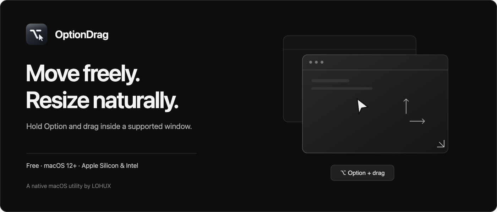
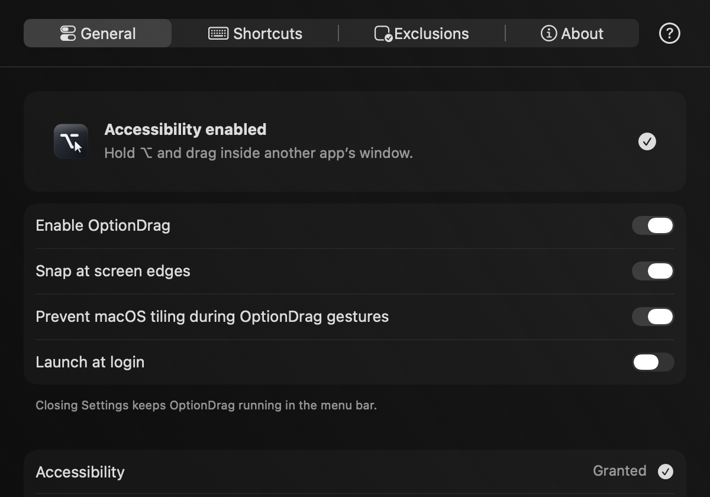
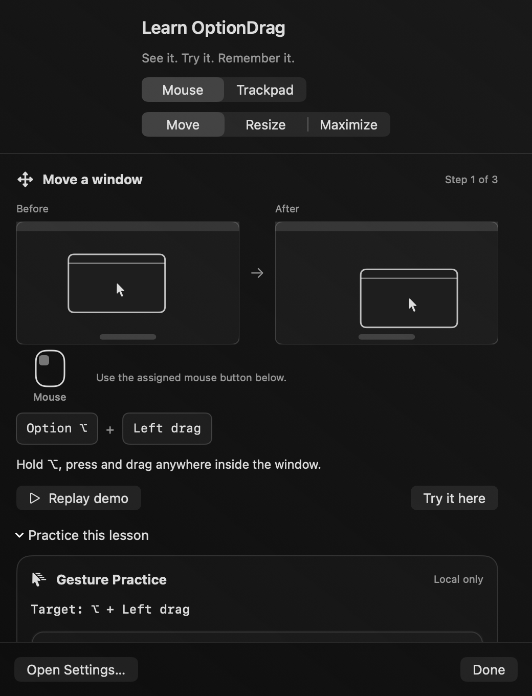

# OptionDrag

Move and resize supported Mac windows by holding Option and dragging with your mouse or trackpad. A native macOS utility by **LOHUX**.

**Free forever.** No account, subscription, activation key or payment required.

**[Download OptionDrag 1.1.0 — DMG](https://github.com/LOHUX/optiondrag-releases/releases/download/v1.1.0/OptionDrag-1.1.0-universal.dmg)**\
[ZIP](https://github.com/LOHUX/optiondrag-releases/releases/download/v1.1.0/OptionDrag-1.1.0-universal.zip) · [Checksums and release notes](https://github.com/LOHUX/optiondrag-releases/releases/tag/v1.1.0) · [Website](https://optiondrag.app/)

## Features

- Move and resize with configurable modifier and mouse-button bindings.
- Arrange windows with side snap, explicit maximize/restore and Escape cancellation.
- Set app exclusions, use menu-bar controls and optionally launch at login.
- Learn gestures with Quick Guide and local Gesture Practice.

Settings and Quick Guide

| Settings | Quick Guide |
| --- | --- |
|  |  |

## Requirements and installation

**macOS 12 Monterey or later · Apple Silicon and Intel · Accessibility permission**

Download the DMG, move OptionDrag to Applications, review macOS security notices and approve Accessibility. [Installation Guide](https://optiondrag.app/help/install/) · [Text instructions](INSTALLATION.md)

**Not Apple notarized.** This release is ad-hoc signed for bundle integrity, not Developer ID signed. Only approve an official download you trust. Stop on damaged-file or malware warnings; see [Apple’s security guidance](https://support.apple.com/en-us/102445). No Screen Recording or Full Disk Access is required.

Monterey on Apple Silicon was accepted by the owner. Intel and every OS/hardware combination have not been exhaustively tested. Update checks open the release page; automatic in-app installation is disabled. Updates may require Accessibility approval again.

## Feedback and support

[Report a bug or request a feature](https://github.com/LOHUX/optiondrag-releases/issues/new/choose) · [Contact LOHUX](mailto:contact@optiondrag.app) · [Optional support](https://optiondrag.app/support/#contribute)

Include your macOS/app version and reproduction steps. Never include passwords, private documents or unrelated logs. Support is optional and does not unlock features.

**Proprietary, closed-source software.** This repository contains distribution documents, artwork and release metadata only. [License](LICENSE.md) · [Privacy](PRIVACY.md) · [Changelog](CHANGELOG.md)
